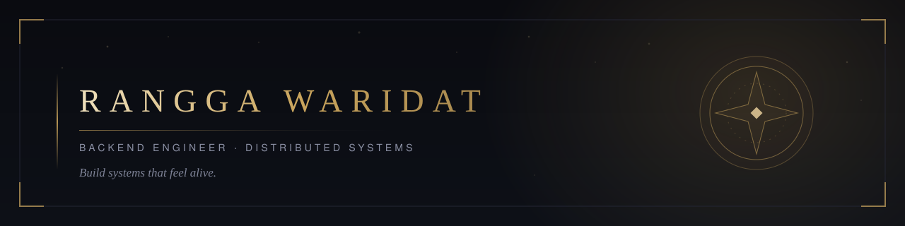

<!--
  Dark fantasy, kept quiet: parchment, gold, and a little ember.
  Requires the assets/ folder: assets/banner.svg · assets/divider.svg
  If you only copy the README, replace the banner with:
  
-->

 

 
&nbsp;&nbsp;&nbsp;

 

## I · The Craft

Backend engineer from Indonesia, drawn to the quiet parts of software — queues, caches, migrations, and the moment a system still holds under load.

I build in **Go**, ship with containers, and treat every service like a small world: clear boundaries, honest logs, no unnecessary magic.

> *Currently focused on scalable backend services and the failure modes of distributed systems.*

## II · The Arsenal

  
  
  
  
  
  
  
  

Tools I am learning to wield — one commit at a time.

<!-- ## III · The Path Ahead

No shortcuts. Just reps, notes, and the occasional 2 a.m. breakthrough.

- [x] Ship a Go service that runs beyond `localhost`
- [x] Containerize it cleanly with Docker Compose
- [ ] Model data and indexes that survive real traffic — **PostgreSQL**
- [ ] Add caching with intent, not hope — **Redis**
- [ ] Connect services over **NATS** and learn to embrace failure
- [ ] Raise a server from bare metal — **Linux · Caddy · Ansible**
- [ ] Read one systems chapter a week, and take notes like they matter

 -->

<!-- ## IV · Selected Work

| Project | About |
| :--- | :--- |
| **[safelink](https://github.com/ranggawaridat/safelink)** | Secure URL shortener — token-based redirection, bot-abuse prevention. |
| **[videco-stream](https://github.com/ranggawaridat/videco-stream)** | Microservice video streaming with HLS transcoding and CDN delivery. |
| **[bukuin](https://github.com/ranggawaridat/bukuin-digital-bookstore)** | Digital bookstore web application, built end to end. |

More in the <a href="https://github.com/ranggawaridat?tab=repositories">archive</a>.

 -->

## III · The Record

  

Consistency over intensity.

 

 

<i>“Always becoming something more.”</i>

 

<a href="https://ranggawaridat.github.io">ranggawaridat.github.io</a>

